<div align="center">





</div>

## Ares A.M.F. — CTO @ Chúuk

Construyo productos de 0 → 1 donde el software toca el mundo físico: **visión por computadora en el campo, laboratorios clínicos y almacenes**. Backend en **Python (FastAPI)**, interfaces en **Vue**, y modelos que corren **en el borde** cuando no hay internet.

Soy **CTO de Chúuk** y estudio Ingeniería en Sistemas Computacionales en Chihuahua, México. 🏆 **1er lugar absoluto — FECI 2025.**

**Siempre abierto a colaborar** — si tienes un problema difícil de software o IA, escríbeme.

```text
ares@github ~ $ cat ahora.txt
→ Llevando AgriTech a parcelas reales (despliegue en campo, 2026)
→ Integrando cálculos bioquímicos en LabSnap junto a Adaca Medical
→ Escribiendo herramientas pequeñas y rápidas, sin dependencias
```

### Productos — Chúuk

| | Proyecto | Qué resuelve | Stack |
|:-:|:--|:--|:--|
| 🌱 | **AgriTech** | Detecta plagas en cultivo con IA, 100 % offline en el campo. | `FastAPI` `YOLOv8n` `Edge` |
| 🧪 | **LabSnap** | LIS para 22+ tipos de estudios clínicos, con respaldo corporativo. | `Laravel` `Vue` `PostgreSQL` |
| 🔬 | **MicroOV** | Análisis microscópico en segundos, guiado por IA. | `YOLOv8` `GPT-4` `FastAPI` |
| 📦 | **Smart-FIFO** | Rotación FIFO garantizada con QR y mapa del almacén. | `FastAPI` `MySQL` |
| 📱 | **CellyApp** | Una base de código para escritorio y Android. | `TypeScript` `Chromium` |

### Open source

| Repo | En una línea |
|:--|:--|
| [**eco_fastapi_template**](https://github.com/Ares-AMF/eco_fastapi_template) | Plantilla FastAPI de bajo consumo: `orjson` + `uvloop` + rate limiting. |
| [**vanilla_fetcher**](https://github.com/Ares-AMF/vanilla_fetcher) | Cliente HTTP < 2 KB con backoff exponencial y modo ahorro de datos. |
| [**disk-audit-cli**](https://github.com/Ares-AMF/disk-audit-cli) | Auditor de disco en paralelo con `os.scandir`, cero dependencias. |

### Stack

<p>
  
</p>

<div align="center">

<a href="https://ares-amf.github.io/Portafolio/"></a>
<a href="https://www.linkedin.com/in/ares-arturo-molina-franco-4883aa35a"></a>

<sub>Fuera del teclado: dibujo, escribo, biología y mucha música 🎶</sub>

</div>
